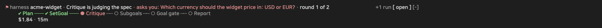
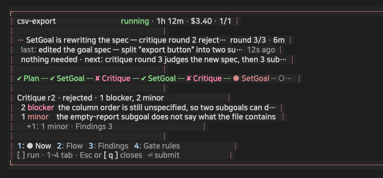
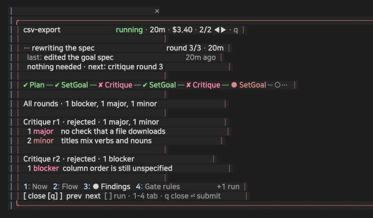
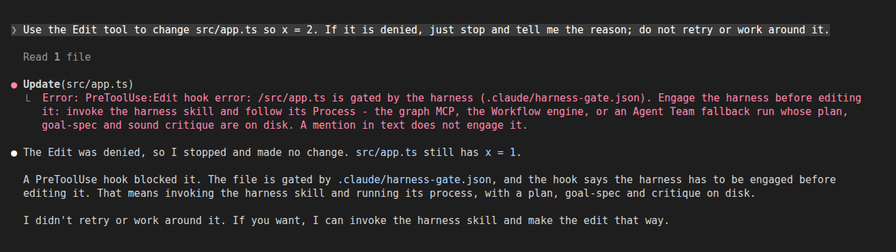

# harness — 한국어

[English](README.md) · **한국어**

큰 요청을 위한 **추론 바닥선(floor)** 입니다. 품질의 천장을 올리는 도구가 아니라, 모든 요청을
여섯 단계 역할로 통과시켜 **반복**과 **기준 미달 답변**을 걸러내는 필터예요. 판정자와 실행자를
분리하는 게 핵심입니다. 계획과 판정은 Opus로 고정하고, 코드 실행과 결정론적 검증은 로컬 Codex
CLI가 있으면 그쪽으로 라우팅합니다.

```
Plan(opus) → SetGoal(opus) → Implement(Codex 사용 시) → Test(Codex 사용 시) → QualityGate(opus, loop) → Report(sonnet)
```

프로젝트가 원하는 경로를 건드리기 전에 하네스 사용을 요구할 수 있도록, opt-in PreToolUse 편집
게이트도 함께 제공합니다.

## 설치 / 제거

```bash
/plugin install harness@newkayak12-claude-skills
/plugin uninstall harness@newkayak12-claude-skills
```

> **trophy 함께 설치.** 이 버전부터 이 플러그인을 설치하거나 업데이트한 뒤 첫 대화형 세션에서, trophy가 없으면 [trophy](../trophy/KOR.md)(업적)를 user 범위로 한 번 설치합니다. 동의하기 전에는 아무것도 보내지 않으며, trophy를 지우면 다시 설치하지 않습니다. 미리 거부하려면: `mkdir -p ~/.claude/plugins/.newkayak12-trophy-ride.done`. `sh`가 필요합니다(sh가 없는 Windows는 해당 없음).

마켓플레이스 설치만으로는 아무것도 강제되지 않습니다 — 스킬이 쓸 수 있게 될 뿐이에요. 대상
프로젝트 안에서 `install` 스킬을 돌려야 거버넌스가 상시화됩니다
([프로젝트에 설치하기](#프로젝트에-설치하기) 참고).

## 오케스트레이션 경로

| 경로 | 언제 | 어떻게 |
|---|---|---|
| **그래프 (기본)** | `graph-engineering` MCP 연결됨 | `graph:orchestrate` — 그래프 엔진이 흐름을 소유하고, 메인 세션은 `graph_next` / `graph_run` / `graph_submit` 루프만 돕니다. 전송용 서브에이전트도, 폴링도 없습니다. `allocation: "balanced"`로 열어야 스테이지가 실제로 분산됩니다 — 생략하면 legacy `ordered`로 떨어져 전부 한 세션에서 돕니다. |
| Workflow 엔진 | 그래프 MCP 없음, Workflow 도구 있음 | `Workflow({ scriptPath: "harness/engine/pipeline.js", ... })` |
| 에이전트 팀 | 둘 다 없음 | `engine/fallback.md` |

그래프 엔진이 생긴 이유: Workflow 경로는 CLI를 Bash로 몰기 위해 Implement/Test 노드마다 서브에이전트를 하나씩 써야 했고, 프로세스를 기다리는 서브에이전트는 폴링밖에 못 합니다. 실측 한 번에서 전송 계층이 추론 계층보다 비쌌습니다(입력 토큰 6.87M vs 2.06M, 전송 계층의 편집은 0건). `graph/README.md` 참고.

## 어떤 스킬을 쓰나

| 하고 싶은 것 | 스킬 |
|---|---|
| 큰 요청을 계획·실행·검증·게이트까지 거쳐서 받고 싶다 | `harness` |
| 기본 그래프 오케스트레이션 경로를 연결하거나 확인하고 싶다 | `graph:install` |
| 프로젝트에 게이트·훅·컨벤션·CLAUDE.md 블록을 심고 싶다 (참고 프로젝트가 있으면 `develop:like-my-code`로 컨벤션 도출) | `install` |
| 프로젝트에서 하네스 거버넌스를 걷어내고 싶다 | `remove` |
| 플러그인 버전을 올린 뒤 이 프로젝트에 설치된 하네스 복사본을 최신으로 맞추고 싶다 | `update` |
| 설치 형태와 무관하게 Implement/Test를 로컬 Codex CLI에 위임하고 싶다 | `codex-control` |

## 스킬

### `harness`

엔진 진입점입니다. 원문 요청을 `engine/pipeline.js`에 그대로 넘기면, 엔진이 스스로 계획을 세우고
goal-spec을 작성·비평한 뒤, 각 subgoal을 스킬이 붙은 실행자로 처리하고, 별도의 Test 에이전트가
결정론적으로 검증하고, subgoal 단위와 전체 결과물 양쪽을 게이트한 다음 리포트를 씁니다.
"그럴듯한" 게 아니라 "검증된" 결과가 필요할 때 쓰세요. 사소한 수정이나 단순 질문에는 쓰지
마세요 — 여섯 단계 비용이 답변 가치보다 큽니다.

```
하네스 돌려줘: 주문 동기화 잡이 업스트림 페이지 크기가 바뀌면 행을 조용히 흘려. 제대로 고치고
각 부분 독립적으로 검증한 다음 보고해줘.
```

기본 모드 B 호출:

```js
Workflow({ scriptPath: "harness/engine/pipeline.js", args: {
  request: "<요청 원문>",
  context: "<선택: 알고 있는 제약>",
  max_retries: 2,
  codex_provider: "off"      // default "off"; "auto" | "required" opt in to Codex
}})
```

`report`, `all_passed`, `failed[]`, `goal_gate`를 돌려주고, 실패도 숨기지 않고 그대로 전달합니다.
엔진이 항상 물리는 세 스킬(Plan의 `agents:agent-task-decomposer`, 스펙 비평·QualityGate의
`think:devils-advocate`, Test의 `completion:verification-before-completion`) 외에, SetGoal이
필요하면 하네스 대응 스킬(`write:plans`, `planning:executing-plans`,
`agents:subagent-driven-development`, `develop:test-driven-development`, `write:writing-skills`,
`agents:dispatching-parallel-agents`, `think:brainstorming`)을 subgoal에 매핑할 수 있습니다.
전부 선택이고, 하나도 안 써도 정상 실행입니다.

### `install`

플러그인이 계속 깔려 있지 않아도 강제가 유지되도록, 프로젝트가 소유하는 하네스 거버넌스 파일을
스캐폴딩합니다. 판단(게이트 패턴, 임베드 여부, 컨벤션, CLAUDE.md 블록)은 스킬이 맡고, 결정론적인
파일 작업은 `install.mjs`가 처리합니다. 전부 멱등이고 비파괴적이라 기존 파일은 `kept`로 보고될
뿐 덮어쓰지 않습니다. 엔진 실행은 이 스킬이 아니라 `harness` 스킬입니다.

```
이 프로젝트에 하네스 설치하고 게이트 켜줘 — Kotlin 소스만 게이트 대상으로.
```

```sh
node "<plugin>/skills/install/install.mjs" '{
  "projectDir": "<프로젝트 루트 절대경로>",
  "gate": { "patterns": ["src/.*\\.kt$"], "window_hours": 2 },
  "embed": { "runtime": true, "skills": [ { "name": "...", "src": "<abs>" } ] }
}'
```

`gate`를 빼면 게이트 파일을 안 쓰고, `embed`를 빼면 standalone 임베드를 건너뜁니다. 플러그인
버전을 올린 뒤에는 `"refresh": true`로 다시 실행하세요 — 플러그인 소유 파일(`goal-gate.mjs`,
`.claude/harness/**`)만 다시 복사하고, 게이트·컨벤션·CLAUDE.md·`settings.json`은 건드리지 않습니다.

### `remove`

프로젝트에 설치된 하네스 거버넌스를 걷어냅니다: 훅, `settings.json` 등록,
`.claude/harness-gate.json`, `.claude/.harness-last-decision.json`, `.claude/harness/`,
`.claude/.harness-markers/`, CLAUDE.md의 펜스 블록, `.gitignore`의 `# harness:begin` ~ `# harness:end` 블록(블록 전체 삭제). `.claude/conventions/`는 프로젝트 소유라 **기본적으로 보존**되고, 지우려면
명시적 확인이 필요합니다. 깨진 `settings.json`이나 짝이 안 맞는 CLAUDE 마커는 완료를 억지로
만들려고 통째로 지우지 않고, 그대로 두고 수동 정리 대상으로 보고합니다. 블록 밖에 있는 `.gitignore`의 하네스 줄은 `legacy-left`로 보고하고 그대로 두며, `# harness:begin` / `# harness:end` 마커가 깨졌거나 중복이면 `marker-error`로 보고하고 파일은 건드리지 않습니다.

```
이 프로젝트에서 하네스 지워줘. 단 .claude/conventions/ 는 우리가 고친 거라 남겨줘.
```

```sh
node "<plugin>/skills/remove/remove.mjs" '{
  "projectDir": "<프로젝트 루트 절대경로>",
  "purgeConventions": false
}'
```

멱등합니다 — 두 번째 실행은 실패가 아니라 `absent`로 보고합니다.

### `update`

플러그인 버전을 올린 뒤 프로젝트에 설치된 하네스 복사본을 최신으로 맞춥니다. 설치 모드는 디스크에서
판별하고(`.claude/harness/`가 있으면 임베드), 임베드된 내용으로 embed 설정을 다시 만들어
`install.mjs`를 `"refresh": true`로 실행합니다 — 새 스크립트는 없습니다. 플러그인 소유 복사본
(`goal-gate.mjs`, `.claude/harness/**`)은 `refreshed` 또는 `unchanged`로 보고하고, 게이트·컨벤션·
CLAUDE.md 블록·`settings.json`은 건드리지 않습니다. 소스를 찾지 못한 임베드 항목이 있으면 멈추고
그 이름을 알려줍니다.

```
하네스 플러그인 올렸는데 이 프로젝트 복사본도 최신으로 맞춰줘.
```

이 소스의 패치 릴리스를 만드는 메인테이너는 `node _repo/scripts/patch-harness.mjs`를 씁니다(저장소
CLAUDE.md의 Update Workflow 참고). 사용자용 스킬이 아닙니다.

### `codex-control`

Codex를 쓰는 Implement/Test 단계가 사용하는 어댑터 탐색 규약입니다. 프로젝트가
`.claude/harness/**`를 임베드했다고 가정하지 않고도 위임이 되게 해줍니다. 존재하는 첫
`codex-exec-adapter.mjs`를 찾아 쓰고, 하나도 없으면 Codex 사용 불가로 기록한 뒤 평소의 Claude
경로로 계속 진행합니다.

```
Implement 단계에서 plugin 모드로 Codex 돌려야 해 — 어댑터부터 찾아줘.
```

탐색 순서:

| # | 형태 | 경로 |
|---|---|---|
| 1 | 명시 인자 | `args.codex_adapter_path` |
| 2 | repo-local | `harness/engine/codex-exec-adapter.mjs` |
| 3 | 임베드 설치 | `.claude/harness/engine/codex-exec-adapter.mjs` |
| 4 | plugin 모드 | 프로젝트 CLAUDE.md Harness 블록의 `scriptPath`에서 유도 |

실행 규약: 위임 전에 반드시 `--detect`, Implement와 Test는 **별개** Codex 프로세스, Implement는
`--sandbox workspace-write` 사용 가능, Test 프롬프트는 검증 전용이라 구현 파일을 고쳐서도 안 되고
명령/파일 증거 없이 Implement의 서술을 믿어서도 안 됩니다.

## 동작 방식

1. **원문 요청을 그대로 넘깁니다.** `Workflow({ scriptPath: "harness/engine/pipeline.js", args: { request: "..." } })`
2. **엔진이 직접 계획하고 goal-spec을 작성합니다** (Opus + 적대적 비평 패스). 그래서 스펙 품질이
   메인 세션 모델에 좌우되지 않습니다. 스키마: [`goal-spec.md`](goal-spec.md).
3. **각 subgoal은 Implement → Test → QualityGate를 반복합니다** (`max_retries`로 상한):
   실행자는 이 저장소의 스킬을 부르고, 별도 Test 에이전트가 명령을 돌리고 산출물을 읽어
   결정론적 증거를 만들고, 별도 Opus 판정자가 그 증거로만 게이트합니다.
4. **goal 레벨 게이트가 조립된 전체를 목표 대비로 채점합니다** (0-100 `match_pct`, 통과 기준
   90% 이상. 미달이면 리페어 패스 후 재게이트) — 그다음 Report 단계가 종합합니다.

`codex_provider: "auto"` 또는 `"required"`면 모든 Implement/Test 단계의 **기본** 경로가 Codex입니다.
최소한의 Sonnet 컨트롤러가 `codex-control`로 어댑터를 찾아 별도 `codex exec --json` 프로세스를
돌리고, 그 출력을 평소의 `HANDOFF`나 증거 JSON 형태로 변환만 합니다 — 성공했는데 자기가 다시
작업하면 안 됩니다. `auto`는 경로 실패 시 Sonnet으로 명시적 강등이 가능하고, `required`는 강등
대신 provider 실패를 보고합니다. `off`면 순수 Sonnet입니다. goal-spec의 `implement_provider` /
`test_provider`는 전제 조건이 아니라 추적용 힌트입니다.

## 모드

- **B (기본):** 원문 요청 + 고정 엔진.
- **DW-off 폴백:** Dynamic Workflow가 꺼져 있거나 Workflow 도구가 없으면, 역할이 분리된 Agent
  Team을 구성해 같은 여섯 역할을 파일 기반 폴백 규약으로 돌립니다
  ([`engine/fallback.md`](engine/fallback.md)). 팀 리드는 조율만 하고 Implement, Test,
  QualityGate는 각각 별개 팀원으로 남아 run 디렉터리의 파일 경로만 주고받습니다. 완료 신호는
  [`engine/fallback-check.mjs`](engine/fallback-check.mjs)라는 객관적 체크입니다.
- **M (메타):** 고정 단계로 표현할 수 없는 제어 흐름(토너먼트, 단계적 에스컬레이션,
  loop-until-dry)이 필요하면 하네스가 전용 Workflow를 *생성*합니다 —
  [`templates/meta-skeleton.js`](templates/meta-skeleton.js)를 복사해 `[META]` Work 블록만
  다시 쓰고 실행합니다. 스켈레톤의 계약(판정자 ≠ 실행자, provider 라우팅, 유한 루프, 결정론적
  Test, goal 레벨 게이트)은 그대로 둡니다.
- **A (수동):** 전용 Workflow를 직접 작성해서 넘깁니다 — [`templates/`](templates/) 참고.

오케스트레이터가 Codex 자신일 때는 `codex`, `codex-exec-adapter.mjs`, `codex-runner.mjs`로 재귀
호출하지 말고, 저장소의 `AGENTS.md` 규약대로 네이티브 Codex 도구로 여섯 단계를 직접 수행하세요.

## 프로젝트에 설치하기

마켓플레이스 설치만으로는 강제되는 게 없습니다. 대상 프로젝트에서 **`install` 스킬**
([`skills/install/SKILL.md`](skills/install/SKILL.md))을 돌려야 거버넌스가 상시화됩니다 —
프로젝트가 소유하는 사본을 만들고, 기존 파일은 절대 덮어쓰지 않습니다:

- `.claude/harness-gate.json` — 확인된 경로 패턴에 편집 게이트를 활성화
- `.claude/hooks/goal-gate.mjs` + `.claude/settings.json`에 머지된 PreToolUse 항목 —
  자기완결적 게이트 훅. 커밋해두면 플러그인 설치 여부와 무관하게 팀 전체에 적용됩니다
  (엔진은 여전히 플러그인에 있습니다 — install 스킬의 gap 노트 참고)
- `.claude/conventions/{coding,verification,boundaries}.md` — 엔진이 읽는 기본 룰셋
  (SetGoal → 승인/테스트 기준, Implement → 준수)
  참고할 프로젝트가 있으면 설치 중 `develop:like-my-code`로 `coding.md`/`boundaries.md`를 채울 수 있습니다 (develop이 없으면 건너뜁니다)
- 프로젝트 `CLAUDE.md`에 덧붙는 펜스 처리된 `## Harness` 섹션
- `.gitignore`의 `# harness:begin` / `# harness:end` 블록: `install`은 `.claude/.harness-markers/`, `.harness-run/`,
  `.claude/.harness-last-decision.json`, `.claude/settings.local.json` 중 없는 줄만 한 줄씩 추가합니다

이후 사본은 프로젝트 소유입니다. 라이프사이클 스킬은 명시적으로 부를 때만 건드립니다:
`install`을 `refresh:true`로 돌리면 플러그인 소유 사본을 갱신하고, `remove`는 설치를 정리합니다.

**강제**는 opt-in PreToolUse 게이트입니다([`hooks/`](hooks/)). 프로젝트가
`.claude/harness-gate.json`에 게이트 대상 경로를 적으면, 그 경로에 대한
`Write|Edit|MultiEdit|NotebookEdit`와 그 경로에 쓰는 `Bash` 명령은 하네스 사용을 요구합니다.
사용 여부는 기록으로만 판단합니다(실제로 실행된 Workflow/graph/teams 도구 호출, 열린 broker 노드,
plan·goal-spec·sound critique가 디스크에 있는 fallback run, 살아 있는 마커). 대화 속 문자열은 인정하지 않습니다.
어디서든 fail-open입니다(v0의 교훈).

- **마커가 사용으로 인정됩니다.** `.claude/.harness-markers/`의 살아 있는 마커는 게이트를 연 것으로 칩니다
  (병렬 서브에이전트용이며 teams가 패키지 워크트리마다 하나씩 씁니다). 타임스탬프가 미래인 마커는 무시합니다.
- **항상 게이트 대상.** `.claude/harness-gate.json`, `.claude/settings.json`과 `settings.local.json`,
  `.claude/hooks/**`, `.claude/.harness-markers/**`는 `patterns`와 무관하게 게이트 대상입니다. 면제는
  하나뿐입니다. 설치된 플러그인에서 실행하는 `node <harness plugin>/skills/remove/remove.mjs ['<json>']`이며,
  프로젝트에 복사된 훅은 이 면제를 주지 않습니다.
- **읽기 전용 명령.** 단순 명령 전체를 차지하는 `grep`, `egrep`, `fgrep`, `rg`, `cat`, `head`, `tail`, `less`, `wc`,
  `ls`, `echo`(그리고 `git log|show|diff|status`)는 아무것도 쓰지 않으므로 그 안의 쓰기 동사나 경로는 판정하지
  않습니다. `$(…)`나 백틱이 들어 있는 명령은 면제되지 않습니다.
- **import.** 정적 상대 `import`(`import { f } from './lib.mjs'`)는 쓰기가 아니고 그 경로도 쓴 경로로 치지 않습니다.
  `node:`나 패키지 import, 동적 `import()`는 그대로 쓰기로 셉니다.

## 라이프사이클 헬퍼

- **`harness:remove`** — 설치된 훅, 등록, 게이트, 임베드 런타임, 마커 캐시, CLAUDE.md 블록,
  `.gitignore` 블록을 제거합니다(`legacy-left` 줄은 그대로 두고, `marker-error`면 파일을 건드리지 않습니다). 프로젝트 소유 컨벤션은 명시적으로 요청하지 않는 한 보존됩니다.
- **`harness:update`** — 플러그인 버전을 올린 뒤 `install.mjs`를 `"refresh": true`로 실행해
  설치된 복사본을 갱신합니다. 사용자 소유 파일은 건드리지 않습니다.

## Mod (Claude Code 라이브 UI)

harness는 작은 mod를 함께 제공합니다. 열린 실행을 단계별로 세는 상태 줄, 지금 도는 실행을 보여 주는 프롬프트 위 세 줄 밴드, 실행·비평 라운드·단위·게이트를 보여 주는 패널입니다. 얼리 액세스이며 선택 사항입니다. 게이트 자체는 커맨드 훅이며 mod 없이도 동작하고, mod는 게이트의 판정 방식을 바꾸지 않습니다.

**버전.** 모듈은 Claude Code 2.1.292 이상에서 로드됩니다. 모듈 API는 얼리 액세스라 릴리스 사이에 바뀔 수 있습니다. 더 오래된 빌드는 모듈을 건너뜁니다. 2.1.284에서 확인했고, stderr에 한 줄(`hooks module not loaded: …`)만 찍힐 뿐 커맨드 훅, MCP, CLI는 그대로 동작합니다. 설치된 플러그인에 모듈이 켜져 있지 않다는 메시지가 나오면 `CLAUDE_CODE_ENABLE_FUNCTION_HOOKS=1`을 설정하세요.

| 실행 환경 | Mod |
|---|---|
| 대화형 터미널 | 켜짐 |
| 데스크톱 앱, Code 탭 | 켜짐 |
| `claude -p`와 헤드리스 어댑터 | 꺼짐(UI 표면 없음) |
| Codex, 또는 플러그인 없음 | 해당 없음, 잃는 것 없음 |

**기능**

- **상태 줄**: 열린 실행을 단계별로 셉니다, `Plan(6) / Implement(11)`. 이 worktree의 `fallback-check --list` 행을 세며(다른 worktree는 다른 세션 몫), 12시간 동안 손대지 않은 실행은 빠지고, 열린 실행이 없으면 줄이 비어 있습니다. 게이트 판정은 여기 나오지 않으니 `/harness-status`를 여세요.
- **밴드**: 프롬프트 위에 지금 도는 harness 실행의 세 줄(harness 실행만, graph 실행은 graph mod 몫). 1행은 하고 있는 일이고 내 답을 기다리면 맨 앞에 `⚑`와 질문이 붙고, 2행은 진행선, 3행은 비용과 시간입니다. 다른 열린 실행은 `+N`. 열린 실행이 없으면 숨깁니다. 1행 끝의 `[ 열기 ]` 버튼을 클릭하면 패널이 열립니다.
- **`/harness-status`**가 그 실행의 지금 탭으로 패널을 엽니다(열린 실행이 없으면 게이트 규칙). Esc나 `q`를 누르면 닫히고, 패널에 포커스가 있을 때 `/harness-status`를 다시 쳐도 닫힙니다(패널에서 친 다른 `/명령`은 그대로 실행됩니다). 패널 머리: **지금**(하고 있는 단계 또는 서브골, 단계의 정형 문장이면 흐리게, 비평이 도는 동안 `round n of max`와 이 단계에서 보낸 시간), **마지막 단계**, **You**(내게 필요한 것, 없으면 "nothing needed"와 다음에 오는 일). 그 아래 진행선: 비평 라운드마다 한 단계, `✘ Critique` 다음 `✔ SetGoal again`이, 상한까지 이어집니다. 탭은 지금, 흐름, 발견, 게이트 규칙입니다(키 `1`-`4`, 선택된 탭은 점과 함께 밝게). 실행이 둘 이상이면 `[` `]`가 클릭 없이 키보드로 실행을 바꾸고 처음과 끝에서 멈추며, 탭 줄이 남은 실행 수를 알려 줍니다.
  - **지금**은 가장 최근 비평 라운드의 발견을 심각도 순으로 보여 주고 나머지는 `+n: …` 한 줄로 줄입니다.
  - **흐름**은 단계를 순서대로 보여 줍니다. 서브골은 게이트 판정으로 펼쳐지며, 반려된 시도는 이유(`↳ …`)를 보여 주고 재시도는 그 한 단계 아래에 놓입니다. 반려된 비평(`sound:false`)과 실패한 목표 게이트도 이유를 보여 줍니다.
  - **발견**은 비평 라운드마다 판정과 심각도별(blocker, major, minor, nit) 발견을 나열하고, 맨 위에 전체 라운드의 합계를 보여 줍니다.
  - **게이트 규칙**: 게이트 패턴, 인게이지 윈도우, 마지막 판정(allow/deny, 도구, 대상, 경과 시간, 사유), 하네스를 인게이지하는 방법. 게이트 설정이 없으면 그렇다고 알려 줍니다.
  - `/harness-status demo [minimal|full|parallel|narrow|off]`는 실제 실행 대신 가상의 실행을 그립니다(스크린샷이나 배치 확인용). `demo off`로 돌아옵니다. 상태 줄은 계속 실제 실행을 셉니다.
- **데이터 출처.** 실행 화면은 세션 폴더의 `.harness-run/<run>/`(계획, 목표 명세, 비평, 게이트 파일, 서브골 폴더)를 읽기 전용으로 읽고, 살아 있는 가장 최근 실행을 따라갑니다. 없으면 가장 최근 실행을 보여 줍니다. 마지막 판정은 게이트 훅이 쓰는 `.claude/.harness-last-decision.json`에서 읽습니다. 로컬 런타임 파일이며 `install`이 gitignore에 넣고 `remove`가 지웁니다. 게이트 설정을 읽을 수 없으면 게이트 규칙 아래에 설정 오류 안내가 표시됩니다.
- **게이트 거부 알림.** 자리를 비운 사이 게이트가 호출을 거부하면 mod가 거부 문장(`⛔ goal gate blocked <Tool>: <path> …`, 또는 harness·teams 안내 문장)을 `PushNotification`으로 보냅니다. 보내지지 않거나(터미널을 보고 있을 때) 같은 경로를 10분 안에 이미 보냈으면 같은 문장을 토스트로 띄웁니다. 세션 시작 전의 거부는 무시, 실패는 조용히 넘어갑니다.
- **실행 알림.** 같은 알림·같은 토스트 대체로 실행의 사건을 알립니다: `harness <run>: <kind> — <stage/subgoal> (<attempt>/<max>)`. 종류는 `rejected`(`02-critique.json` `sound:false`, 보고 전에 실패한 subgoal의 `gate-<n>.json` 또는 `04-goal-gate.json`), `failed`(subgoal `result.json`의 `passed:false`, 또는 `05-report.md`가 있는데 goal 게이트 실패), `complete`(실패 없이 `05-report.md` 작성; graph 실행은 graph mod가 알림). 실행·단계(subgoal)·종류·시도마다 한 번, 세션 시작 이후에 쓰인 파일만, 대화형 세션에서만, 실패는 조용히 넘어갑니다.
- **언어.** 기본은 영어이고, Claude Code의 `language` 설정이 한국어이면 한국어로 표시됩니다.

알려진 제약: 상태 줄은 게이트 설정을 세션의 작업 디렉터리 기준으로 읽습니다. UI 표면 없이(헤드리스 또는 SDK 호스팅) 시작한 세션은 나중에 클라이언트가 붙어도 mod가 꺼진 채로 남습니다. 새 세션을 시작해야 켜집니다(바뀌지 않은 mod를 다시 로드해도 session.start는 다시 발생하지 않습니다).

### 스크린샷

Claude Code 2.1.293 대화형 터미널 세션에서 실제로 캡처했습니다.


실행이 내 답을 기다리는 동안의 밴드: `⚑`, 질문, 진행선, 비용과 시간, 다른 실행은 `+1 run`, 패널을 여는 `[ 열기 ]` 버튼. 한눈에 내가 할 일이 있는지 압니다.


비평 루프 중인 실행의 `/harness-status` 지금 탭: 하는 일, 마지막 단계, 내게 필요한 것, 반려된 라운드가 보이는 진행선. 창을 열면 이 탭이 먼저 보이고, `[` / `]`로 실행을 바꿉니다.


발견 탭(키 `3`): 비평 라운드마다 심각도별 발견. 파일을 읽지 않고도 라운드가 왜 반려됐는지 압니다.


하네스를 켜기 전에 게이트 대상 경로를 Edit하려 하자 게이트 훅이 거부한 장면.


모드는 폴백 실행의 결과(실패 없이 보고서가 나오면 `pass`, 보고서 뒤 목표 게이트 실패면 `reject`, 하위 목표 실패면 `fail`, id 없음)를 상태 값 `harness.outcome`으로도 발행합니다. `trophy` 플러그인의 옵트인 집계용입니다.

## 상태
- v1.38.0 — `/harness-status`가 지금 무엇을 하는지, 마지막에 무엇을 했는지, 사용자를 기다리는지 보여 줍니다. 단계 흐름에 비평 루프가 "n번째 / 최대"로 나오고, 지적 사항은 라운드를 걸쳐 심각도별로 나열되며, `[` `]`로 run을 바꾸고 끝에서 멈춥니다. 비평 횟수를 다 쓴 run이 다음 단계로 넘어간 뒤에도 "critique"로 보이던 문제를 고쳤습니다. 띠는 harness run만 보여 주고 걸린 시간을 한 번만 말합니다. 상태줄은 run 자신의 단계로 셉니다. 실패 토스트가 이유와 다음 단계(`retry n/m`, `needs you`, `gave up`)를 보여 줍니다.
- v1.37.0 — `/harness-status`(이전 `/harness-gate`): 지금 줄, 흐름 탭(단계, 반려 사유와 그 아래 재시도, 반려된 비평 포함), 상세 탭(서브골별 결과, 모든 관문 판정, 목표 관문 일치율, 게이트 규칙). Esc, q, 같은 명령으로 닫힙니다.
- v1.36.0 — mod가 run 결과(통과·반려·실패, run과 결과마다 한 번)를 자기 `outcome` 상태로 발행해 trophy가 셉니다. id는 담지 않고, trophy가 없어도 harness는 똑같이 동작합니다.
- v1.35.0 — 게이트가 막을 때(경로당 10분에 한 번)와 run 반려·실패·완료 때 mod가 푸시 알림을 보냅니다(못 보내면 토스트). graph run은 graph mod에 맡깁니다.
- v1.34.1 — Codex는 스키마 호환 훅 오버레이를 사용하면서 편집 및 중첩 run 진입 호출에 대한 goal gate를 그대로 유지하며, Claude 훅은 변경되지 않습니다. 진입 스킬이 아닌 Skill 호출은 오버레이 이전처럼 게이트를 바로 통과합니다(참여 마커를 갱신하지 않음). Codex `apply_patch`의 이름 변경(`*** Move to:`)도 새 경로로 판정합니다. Codex 오버레이는 SessionStart의 trophy 설치 훅을 일부러 넣지 않습니다(trophy는 Claude 전용).
- v1.34.0 — harness 플러그인이 켜져 있으면 프로젝트 goal-gate 복사본은 판정을 플러그인에 맡김(오래된 복사본이 판정하지 않음); plan 프롬프트에서 게시 중단된 assist 플러그인 제거
- v1.33.0 — harness 안의 harness 금지: goal gate에 막힌 서브에이전트(agent_id)나 run 노드(HARNESS_NODE=1)는 멈추고 호출자에게 보고하라는 안내를 받고, 진입 스킬(harness, graph:orchestrate, teams:orchestrate/develop/sprint/document/plan/qa) 호출은 거부됨; 모든 거부 문구에 이를 명시; 프로젝트 goal-gate 복사본이 플러그인과 다르면 harness:update를 안내하는 토스트 하나
- v1.32.0 — teams도 설치돼 있으면 goal-gate 거부가 종류로 안내(단순 개발 → graph, 없으면 harness 스킬; 스펙·기획·QA·여러 영역·애매함 → teams:orchestrate), 충돌은 토스트 하나로 알림
- v1.31.2 — fallback: goal-gate FAIL인 COMPLETE는 done이 아니라 미달 AC-n과 함께 끝남으로 보고
- v1.31.1 — fallback-check: goal gate 0%는 INCOMPLETE로 판정, todo로 시작하는 제목은 placeholder로 보지 않음
- v1.31.0 — SetGoal이 AC 계약을 요청 크기에 맞춥니다: 동작 보존 요청(리팩터링·이름 변경·이동)이나 한 줄 수정은 증거 하나(기존 테스트 + 동등성/회귀 확인 하나)짜리 AC-1 하나만 쓰고, 누락 기준 점검은 생략하며, spec에 `proportional: <이유>`를 적습니다. gate 표는 한 줄. (2026-10-12)
- v1.30.0 — Goal gate: 프로젝트 밖으로의 `cd`가 상대 경로를 게이트 대상으로 끌어오지 않습니다(명령 구간마다 디렉터리를 추적하고, 서브셸·`||`·`cd $VAR`는 넓은 범위를 유지). 스크립트 파일을 실행하는 명령(bash/sh/python/node/ruby, `./x`, `. x`, `sh -c "$(cat x)"`)은 인라인 스크립트처럼 파일 내용으로 판정합니다. 게이트 대상이거나 git에 추적되고 수정되지 않은 레포 스크립트는 제외. 새 deny가 기록되면 모드가 토스트를 띄웁니다. (2026-10-12)
- v1.29.0 — SetGoal이 goal 수준 acceptance를 AC-n으로 씁니다(`specs/<feature>/spec.md`의 ID를 재사용, 없으면 누락 기준 점검 후 Given/When/Then, 모르는 사실은 `[확인 필요]`). goal gate는 AC-n마다 증거 한 줄(증거 없으면 미충족)과 spec 밖 변경을 보고합니다. (2026-10-12)
- v1.28.1 — Plan 프롬프트 플러그인 목록에 assist:* 추가(assist 베타 플러그인).
- v1.28.0 — Goal gate: 프로젝트 안의 링크된 워크트리(설정은 추적, run은 gitignore)도 메인 루트의 진행 중 run을 봅니다. 다른 구간이 변수로 쓸 때 읽기 전용 구간(grep/cat/diff)의 경로를 더 이상 게이트 대상으로 끌어오지 않습니다. (2026-10-12)
- v1.27.1 — Plan 프롬프트가 현재 스킬 플러그인 목록을 씁니다(pm:* 제거, 그 일은 planning:*와 write:plans가 맡음). 심볼릭 링크 경로(macOS /tmp -> /private/tmp)로 들어온 형제 워크트리도 goal gate가 검사합니다. (2026-10-12)
- v1.27.0 — install이 참조 프로젝트 여부를 물음(기본 아니오). 있으면 `develop:like-my-code`가 그 스타일로 `.claude/conventions/coding.md`·`boundaries.md`를 채움(규칙마다 레포 근거와 인용 출처). develop이 없으면 건너뜀
- v1.26.2 — trophy 함께 설치: 업데이트 후 첫 대화형 세션에서 trophy가 없으면 한 번 설치(삭제는 존중)
- v1.26.1 — Mod: 밴드와 상태 줄이 이 worktree의 실행만 셈(다른 worktree는 다른 세션 몫)
- v1.26.0 — Mod: `/harness-gate` 패널이 teams 0.46.0 스타일의 실행 화면이 됨: 실행 / 단위 / 게이트 탭(키 `1`-`3`), 6단계 진행선, 단위별 상태, goal gate 일치율 막대, 지금 하는 일. `/harness-gate`는 게이트 탭으로 열림(게이트 정보는 그대로, 게이트 설정을 읽을 수 없을 때의 안내 추가). 1.25.0의 상태 줄과 파이프라인 밴드는 유지. 기본 영어, Claude Code `language`가 한국어면 한국어. mod 테스트 38개, 실제 Claude Code 영어·한국어 캡처로 확인
- v1.25.1 — Mod: 밴드 호버 카드가 단계 줄 아래에 펼쳐짐(밴드 위로 띄운 카드는 잘렸음; 실제 화면에서 확인); graph 실행은 요청 문장으로 표시
- v1.25.0 — Mod: 상태 줄이 열린 실행을 단계별로 셈(fallback + graph, 모든 worktree: `Plan(6) / Implement(11) · graph Implement(3)`); 프롬프트 위 파이프라인 밴드(단계 칩, 호버 시 실행별 진행 카드); Ink 스타일 `/harness-gate` 패널. 게이트 판정은 이제 패널에만 표시
- v1.24.0 — Mod(Claude Code 2.1.292+, 얼리 액세스): 게이트 상태 줄과 `/harness-gate` 패널; goal gate가 마지막 판정을 `.claude/.harness-last-decision.json`에 기록(install/remove가 이 파일을 관리)하고 간접 경로로 쓰는 대상도 판정
- v1.23.0 — `harness:patch`가 사용자 스킬에서 빠짐(메인테이너 스크립트는 `_repo/scripts/patch-harness.mjs`로 이동); 새 `harness:update`가 `install.mjs` `"refresh": true`로 설치된 복사본을 갱신
- v1.22.8 — codex-control에 Related Skills 섹션과 한국어 시나리오 추가(레포 점검)
- v1.22.7 — 저장소 스크립트가 `_repo/`로 이동; patch 스킬이 `_repo/scripts/validate_plugins.py`를 실행
- v1.22.6 — 하네스 대응 스킬 write:writing-plans가 write:plans로 이름 변경
- v1.22.5 — 다섯 스킬 모두 What Claude Does / What You Do 표 형식으로 통일.
- v1.22.4 — goal gate의 Bash 판정은 오탐 없는 기본 거부: 쓰기 동사는 단순 명령 전체를 가진 읽기 전용 명령의 평범한 인자일 때만 예외(`grep -n cp x.mjs`; `rg --pre`, `less -o`, `$(…)`는 아님); 래퍼와 명령 안 어디든 있는 인터프리터/셸도 판정; `git --output` 포함; 인라인·heredoc 스크립트는 쓸 수 있을 때만 이름 붙은 경로를 셈, 데이터 heredoc은 리다이렉트만(본문이 쓰거나 그 파일이 코드이거나 나중에 실행되면 예외); heredoc은 따옴표 밖에서만 찾고 닫히지 않으면 전체로 판정; broker 원장 `.harness-run/broker/`를 게이트
- v1.22.3 — goal gate는 기록(실제 실행된 도구 호출, broker 노드, sound critique가 있는 fallback run)으로만 열림 - 대화 문자열 불인정; 루트를 대상 파일에서 찾음(하위 디렉터리, 형제 worktree); 자기 설정·훅·settings를 게이트; Bash 쓰기 판정; 미래 타임스탬프 무시; install이 기존 matcher 확장 및 .harness-run/ 무시
- **이 지점 이전 항목**: 여기부터 새로 쌓이는 항목이 실제 릴리스 이력입니다. v1.22.2 이하의
  이전 변경 이력은 이 파일에 한국어로 없습니다 — 패치 도구(`patch.mjs`)가 최근까지 이 파일에는
  쓰지 않고 `README.md`에만 기록했기 때문입니다. 전체 이력은 영어
  [README의 Status](README.md#status) 섹션에서 볼 수 있습니다.

진입점: [`harness`](skills/harness/SKILL.md), [`install`](skills/install/SKILL.md),
[`remove`](skills/remove/SKILL.md), [`update`](skills/update/SKILL.md),
[`codex-control`](skills/codex-control/SKILL.md).
