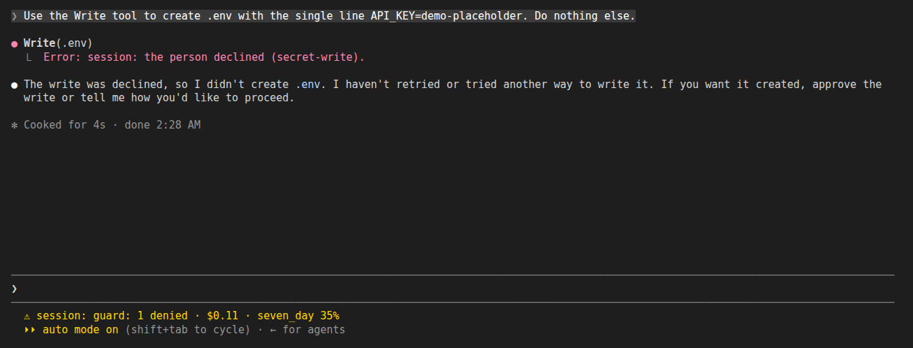
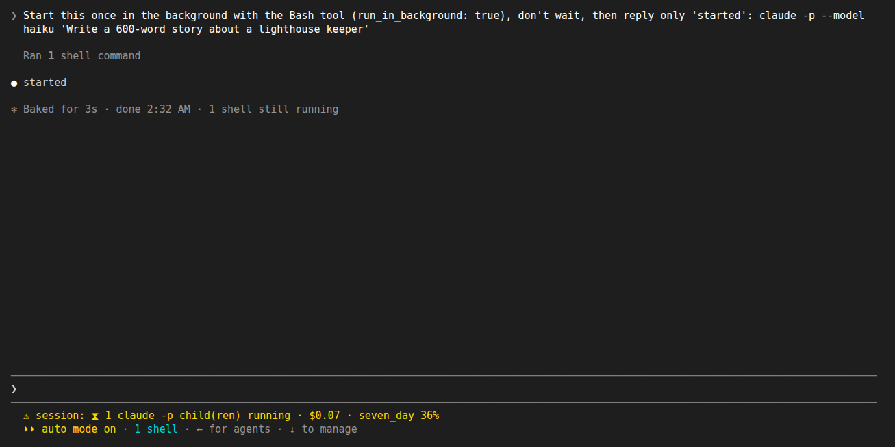
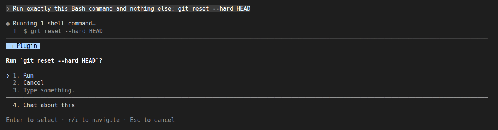
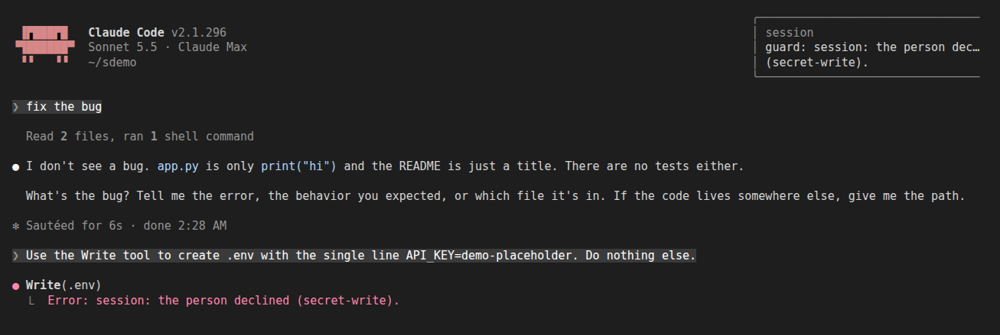
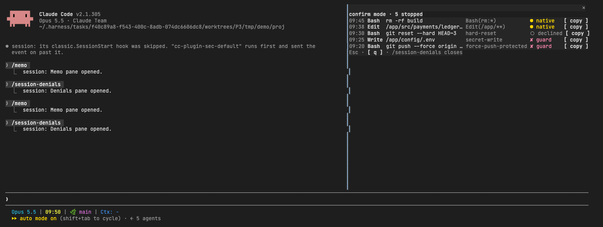
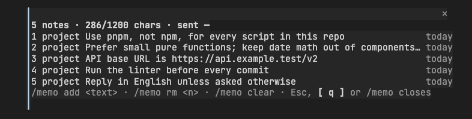
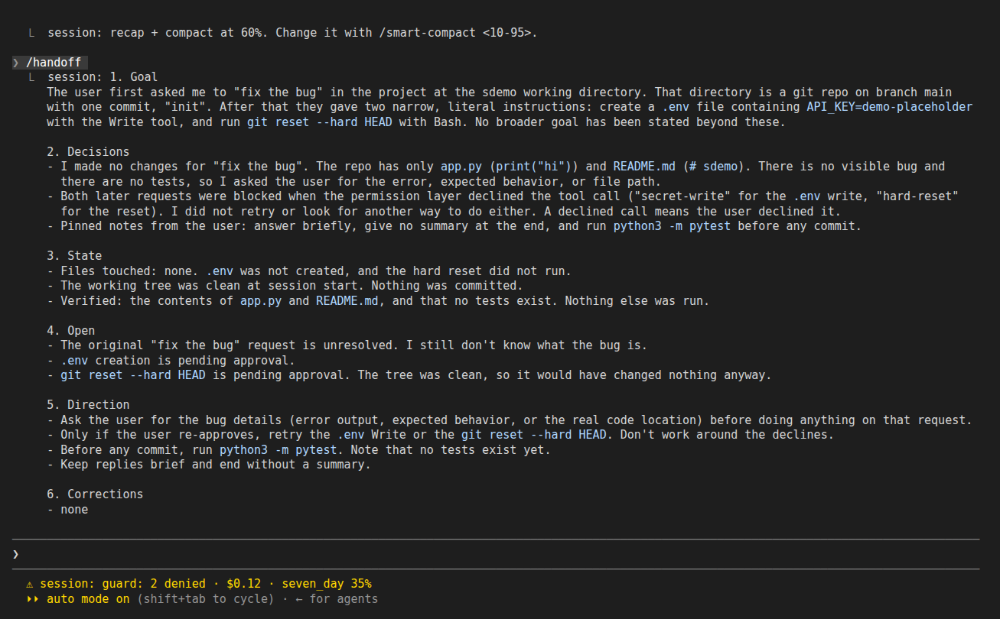
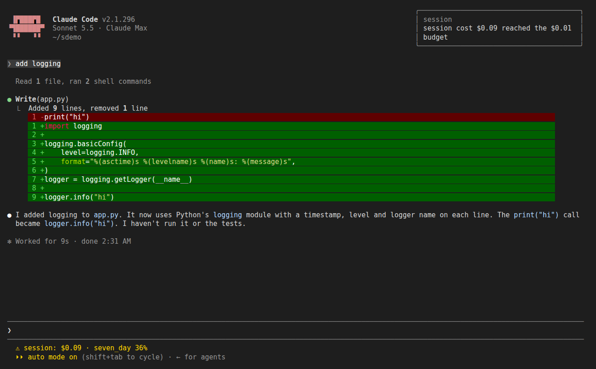
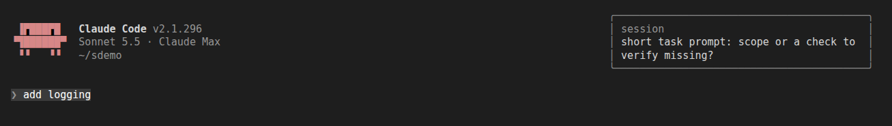

# session

Claude Code 세션이 남긴 것(변경한 파일, 커밋, 거부된 호출, 도구 호출 사이 가장 긴 간격)을 보여 주고, 다음 시작 때 밴드로 다시 보여 주며, 남아 있는 `claude -p` 자식 프로세스를 나열하고 안전하게 중지하며, 위험한 명령과 비밀 파일 쓰기를 가드하고, `/memo` 메모를 보관하고, 정한 %에서 recap 뒤 compact하며, 그 recap을 `/handoff`·`/last-recap`·`/lessons`에 쓰고, 작업 시간과 비용을 보여 주고, 열린 세션 전부를 `/board` 한 화면에(각 세션의 harness·graph·teams 실행과 함께) 보여 주며, main이 바뀌면 같은 저장소의 다른 세션에 알리고, 모델 없이 Agent를 호출하면 경고하며, 끝나지 않은 에이전트를 `/reap`으로 중지합니다. 버전 `0.5.6`. Claude Code 2.1.292 이상(hooks 모듈)이 필요합니다. 이 마켓플레이스의 다른 것은 필요 없습니다.

## 설치
```
/plugin install session@newkayak12-claude-skills
```

> **trophy 함께 설치.** 이 버전부터 이 플러그인을 설치하거나 업데이트한 뒤 첫 대화형 세션에서, trophy가 없으면 [trophy](../trophy/KOR.md)(업적)를 user 범위로 한 번 설치합니다. 동의하기 전에는 아무것도 보내지 않으며, trophy를 지우면 다시 설치하지 않습니다. 미리 거부하려면: `mkdir -p ~/.claude/plugins/.newkayak12-trophy-ride.done`. `sh`가 필요합니다(sh가 없는 Windows는 해당 없음).

## /session
`/session`은 두 개의 보기가 있는 패널 하나를 엽니다. 버튼 또는 `1` / `2` 키로 전환합니다.
- **Retro `[1]`**: 이 세션에서 Claude가 수정하거나 쓴 파일(`git diff --numstat`의 `+추가 -삭제` 포함), 만든 커밋(해시와 제목), 거부된 도구 호출(도구와 이유), 한 턴 안에서 도구 호출 사이 가장 긴 간격.
- **Orphans `[2]`**: 이 세션 아래에서 아직 실행 중인 `claude -p` 자식 프로세스를 한 줄씩 표시합니다. pid, 명령, 경과 시간, `[stop]`. 백그라운드 셸과 서브에이전트는 `/tasks`를 안내하는 한 줄만 있고, 이 플러그인은 나열하지 않습니다. 변경 내용 전체는 `/diff`로 보세요.

`/session retro`는 Retro 보기를 엽니다. 이 세션에서 아직 아무 일도 없으면 지난 세션이 남긴 요약을 보여 줍니다.

## Retro 밴드
세션이 끝나면 요약이 저장됩니다(`claude -p` 실행도 포함). 다음 인터랙티브 시작 때 프롬프트 위에 한 줄이 나옵니다. `last session: 4 files, 2 commits, 1 denied, longest gap 6m12s`, 그리고 `[Retro]`, `[dismiss]` 버튼. dismiss하면 저장된 요약이 삭제됩니다. 저장소에는 아무것도 쓰지 않습니다.

## 자식 프로세스 안전 중지
`[stop]`은 다음 확인을 거쳐 프로세스 하나에 `SIGTERM` 하나만 보냅니다.
1. 새 프로세스 표를 읽습니다. pid가 여전히 이 세션 프로세스 아래에 있어야 하고, 세션 자신이나 그 조상이면 안 됩니다.
2. 명령과 시작 시각이 방금 본 것과 같아야 합니다(재사용된 pid는 거부).
3. 전체 명령이 보이는 확인 창에서 승인합니다.
4. 신호 직전에 확인을 한 번 더 합니다.

`kill -9`, 프로세스 그룹, 패턴 kill, "전체 중지"는 없습니다. 거부되면 토스트만 보이고 아무것도 보내지 않으며, 이미 끝난 프로세스는 행만 지워집니다.

래퍼 셸과 그 `claude -p` 자식은 한 행으로 보이며, `[stop]`은 안쪽 `claude -p`를 대상으로 합니다.

## 상태줄
플러그인은 상태줄을 하나 씁니다. 이 세션에 끝나지 않은 에이전트가 있으면 `⧗ N agent(s) · /reap`, 자식이 살아 있으면 `⧗ N claude -p child(ren) running`(둘 다 턴이 끝날 때마다 갱신), 가드가 무언가를 거부하면 그 즉시 `guard: N denied`를 표시합니다. 해당하는 부분은 작업 뒤, 비용 앞에 ` · `로 이어 붙입니다. 모두 비었을 때만 지워지며, 헤드리스 실행에서는 아무것도 표시하지 않습니다.


*가드가 `.env` 쓰기를 거부한 뒤의 상태줄: `guard: 1 denied · $0.11 · seven_day 35%`.*


*백그라운드로 띄운 `claude -p` 자식: `⧗ 1 claude -p child(ren) running`.*

## 가드
Bash 명령이나 Write/Edit가 실행되기 전에 몇 가지 규칙으로 검사해 먼저 묻습니다(모드에 따라 막기만 하기도 합니다). 모든 저장소에서 동작하며 bypass-permissions 세션도 포함합니다.


*`hard-reset` 규칙: `git reset --hard HEAD` 전에 Run / Cancel을 묻습니다.*


*`secret-write` 질문에 Cancel: toast와 모델이 돌려받는 이유.*

### 규칙
| 규칙 | 걸리는 경우 | 기본 |
|---|---|---|
| `recursive-delete` | 재귀+강제 플래그의 `rm`이 `/`, `~`, `$HOME`, 저장소 루트, cwd의 상위, 또는 그 glob을 가리킬 때 | 확인 |
| `force-push-protected` | `main`, `master`, `trunk`, 원격 기본 브랜치, `guard_extra_protected_branches`에 대한 `-f`, `--force`, `--force-with-lease`, `+branch` refspec의 `git push`. 옵션 없는 force push는 현재 브랜치가 보호 대상일 때 해당 | 확인 |
| `hard-reset` | `git reset --hard`, `git clean -f`(`-n` 제외) | 확인 |
| `worktree-dirty-remove` | 커밋 안 된 변경이 있는 워크트리에 `git worktree remove --force` | 차단 |
| `secret-write` | `.env`(`.env.example` 제외), `*.pem`, `*.key`, `id_rsa` 등, `.aws`·`.ssh` 등 아래 자격 증명, 또는 `guard_secret_paths`에 대한 Write/Edit | 확인 |
| `running-script` | 지금 실행 중인 프로세스가 있는 `.sh` 파일에 대한 Write/Edit | 차단 |

명령을 먼저 나눠서 검사하므로 `cd x && rm -rf /`는 잡히고, `grep -r "rm -rf" .`나 `rm -rf node_modules`는 잡히지 않습니다. 해석할 수 없는 명령은 통과합니다.

### 모드
`/config`에서 `guard_mode`를 설정합니다.
- `confirm`(기본): 확인 규칙은 `Run` / `Cancel`을 보여 주고, 차단 규칙은 이유와 함께 거부합니다.
- `deny`: 확인 규칙도 묻지 않고 거부합니다.
- `off`: 아무것도 검사하지 않습니다. 탈출구입니다.

bypass는 네이티브 프롬프트가 없다는 뜻이지 안전망이 없다는 뜻이 아닙니다. bypass에서도 가드는 묻습니다. 헤드리스(`claude -p`)에는 물어볼 사람이 없으므로 모든 규칙을 통과시키고 아무것도 기록하지 않습니다.

### 다루지 않는 것
샌드박스가 아닙니다. `python -c`, `find -delete`, `dd`, 셸 alias, 같은 일을 하는 스크립트는 검사하지 않습니다. 비밀 파일은 경로로만 판단하며 쓰는 내용은 읽지 않습니다.

### 거부 로그
`/session-denials`는 거부된 호출 패널을 최신순으로 열며, 머리줄에 가드 모드와 중지된 횟수가 나옵니다(`confirm mode · 6 stopped`). 중지된 호출 하나가 한 행입니다. 로컬 시각(HH:MM), 도구, 호출 내용, 막은 규칙, 출처, 그리고 `/permissions`에 넣을 규칙을 보여 주는 `copy` 버튼이 순서대로 나옵니다. 출처는 단어보다 먼저 표시와 색으로 읽힙니다. `✘`(빨강) `guard`, `○`(흐림) `declined`, `●`(주황) `native`. 패널보다 긴 호출은 `…`으로 잘립니다. Esc, `q`, 또는 `/session-denials`를 다시 치면 닫힙니다. 항목에는 도구, 가린 호출(토큰, `NAME=value`, URL 비밀번호는 마스킹. 파일 호출은 경로만 저장), 이유, 가드의 규칙 id, 출처가 들어갑니다. 플러그인 저장소에 최근 200개까지 보관하며 저장소에는 아무것도 쓰지 않습니다. `log_enabled`로 끌 수 있습니다. 가드가 본 네이티브 권한 거부도 기록하지만, 네이티브 대화상자에서 직접 누른 "No"는 기록하지 않습니다.


*`/session-denials`: 중지된 호출 5건, 한 행에 하나씩 최신순. 토스트가 뜨거나 호출이 거부된 뒤에 무엇이, 언제, 어떤 규칙과 출처로 중지됐는지 알려 주고, `copy`는 허용할 규칙을 보여 줍니다.*

## 메모
`/memo`는 다음 프롬프트에 함께 실리는 짧은 메모를 보관해, `/compact`나 `/clear` 뒤에도 모델이 다시 보게 합니다.

### 명령
| 명령 | 동작 |
|---|---|
| `/memo` | Memo 패널을 엽니다. 머리줄에 메모 수, 한도 대비 크기(`<n>/1200 chars`), 메모가 이 대화와 함께 마지막으로 나간 시각(첫 전송 전에는 `—`)이 나오고, 그 아래 한 줄에 메모 하나씩 번호, 범위 배지(`global` 또는 `project`), 본문, 나이(`today`, `2d`)가 오른쪽 끝 열에 나오고, 14일이 되면 나이가 노란색으로 바뀝니다(`CLAUDE.md`로 옮기라는 힌트). 긴 본문은 `…`으로 잘리고, `+N not sent`는 한도 때문에 빠진 저장된 메모 수입니다. Esc, `q`, 또는 `/memo`를 다시 치면 닫힙니다 |
| `/memo add [--global] <text>` | 메모 추가(기본은 프로젝트) |
| `/memo list` | Memo 패널 열기(headless에서는 메모 출력) |
| `/memo rm <n>` | `list`의 번호 `n` 메모 삭제 |
| `/memo clear [--global]` | 프로젝트 메모 또는 전역 메모 비우기 |


*Memo 패널: 한 줄에 메모 하나씩 범위 배지와 나이가 나오고(14일이 되면 나이가 노란색), 머리줄에 한도 대비 크기와 마지막 전송 시각이 나오며, 한도 때문에 빠진 메모가 있으면 `+N not sent`로 나옵니다. 메모를 추가하거나 지우기 전에 열어 모델이 지금 무엇을 갖고 있는지 확인하세요.*

### 범위와 한도
범위는 프로젝트(저장소 루트 기준)와 전역 둘입니다. 한도는 둘을 합쳐 셉니다. 메모 8개, 각 280자, 전체 1200자이며 넘으면 이유와 함께 추가를 거부합니다. 메모는 14일이 지나면 오래된 것으로 봅니다. 주입되는 블록은 고정 머리말 다음에 `[global]`, `[project]` 메모 순입니다. 대화마다 한 번 실리고, `/compact`나 `/clear` 뒤, 또는 내용이 바뀐 뒤 다음 프롬프트부터 다시 실립니다.

CLAUDE.md도 자동 메모리도 아닙니다. 메모는 파일이 아니고, 저장소에 쓰이지 않으며, 공유되지 않습니다. 오래 갈 규칙은 `CLAUDE.md`에, 지금 고정해 두고 싶은 것은 메모에 두세요.

## 스마트 compact
정한 컨텍스트 %에 닿으면 먼저 다음 단계에 맞춘 세션 recap(목표, 다음 방향, 하던 작업과 파일:줄, 결정, 남은 일, 교정)을 받고, 그 recap을 요약 자체로 넣어 compact합니다. compact는 recap에 없는 것만 덧붙이므로 같은 내용이 두 번 실리지 않고 끝난 작업은 빠집니다.

| 명령 | 하는 일 |
| --- | --- |
| `/smart-compact` | 현재 임계치(기본 70%), 마지막 점검, 이 프로세스의 집계 출력 |
| `/smart-compact <10-95>` | 임계치 설정. `60`, `60%` 둘 다 됩니다 |
| `/smart-compact log` | 최근 점검 10개를 최신순으로: `23% vs 10% → recapping → compacted` |

같은 값이 `/config`의 **Smart compact threshold (%)** 항목입니다. 메인 루프 턴이 답변으로 끝난 뒤에 돌고, 긴 턴 안에서는 툴 호출 사이에도 사용량을 확인합니다. 턴 도중 compact가 거절되면 턴이 끝날 때까지 기다립니다. 인터랙티브 세션에서만 동작하고 서브에이전트에서는 동작하지 않습니다. recap이 실패하면 아무것도 하지 않고 내장 auto-compact에 맡깁니다. auto-compact 지점보다 낮게 잡으세요. 높으면 auto-compact가 먼저 돕니다. %는 상태줄과 같은 모델 전체 창 기준이라, 1M 창에서 70%는 700k 토큰입니다.

인터랙티브 메인 루프 턴을 점검할 때마다 50개짜리 로그(원래 %, 임계치, 판단, 결과)에 남고, `/smart-compact log`가 보여 줍니다. 서브에이전트와 헤드리스 턴은 프로세스 안에서 집계만 하며, `/smart-compact`가 그 집계와 로그 쓰기 오류를 함께 보여 줍니다.

## Recap, handoff, lessons
smart-compact나 `/handoff`가 만든 recap은 프로젝트별로 마지막 하나가 보관됩니다. 다른 세션의 recap은 시작할 때 밴드로 한 번만 보여 줍니다. Recap이나 dismiss를 누르면 다시 보여 주지 않고, 세션이 직접 쓴 recap(smart-compact의 recap)으로는 밴드를 띄우지 않습니다.

| 명령 | 하는 일 |
| --- | --- |
| `/handoff` | 지금 recap을 만들어 보관하고 보드의 Recap 탭으로 열기 |
| `/handoff <session>` | 같은 동작에 더해 그 세션(피어 세션 이름이나 id)으로 전송 |
| `/last-recap` | 이 프로젝트의 마지막 recap(7일 이내)을 보드의 Recap 탭으로 열기 |
| `/lessons` | recap에서 모은 "두 번 이상 고친 것" 목록(최근 20개)을 보드의 Lessons 탭으로 열기. `/lessons clear`로 비우기 |

headless 실행(`claude -p`)에서는 이 명령들이 텍스트를 출력합니다. 다음 시작 때 밴드에 `last recap of this project, <경과>`와 **Recap** 버튼이 나오고, 누르면 보드의 Recap 탭이 열립니다. lessons는 어디에도 자동으로 쓰지 않습니다. 남길 만한 것은 직접 `CLAUDE.md`로 옮기세요.


*`/smart-compact 60` 다음 `/handoff`: 6개 항목 recap을 출력하고 보관합니다.*

## 작업 타이머
`/task <이름>`으로 시작, `/task`로 확인, `/task done`으로 종료, `/task log`로 오늘 이름별 합계를 보드의 Today 탭에서 봅니다(headless에서는 출력). 진행 중에는 상태줄에 `⏱ <이름> 12m`이 1분마다 갱신되고, 새 작업을 시작하면 이전 작업은 끝난 것으로 기록됩니다.

## 비용
턴마다 상태줄에 세션 비용과 가장 높은 rate limit 사용률이 나옵니다(`$1.23 · 5h 42%`). `/config`의 **Cost budget (USD)**를 정하면 그 금액에 닿을 때 toast가 한 번 뜹니다(0이면 끔).


*Cost budget을 $0.01로 둔 경우: 첫 턴 뒤의 toast와 상태줄의 비용.*

## 프롬프트 힌트
기본은 꺼짐입니다(`/config`의 **Prompt hint**). 켜면 20자 이하이면서 작업을 요청하고(fix/add/만들/고쳐…) 경로·코드·검증 기준이 없는 프롬프트에 범위나 검증 기준을 묻는 toast가 10분에 한 번까지 뜹니다. 프롬프트 자체는 바꾸지 않습니다.


*Prompt hint 켬: `add logging`에 범위·검증 기준 toast가 뜨고, 프롬프트는 그대로 실행됩니다.*

## 보드
`/board`는 이 플러그인이 있는 열린 인터랙티브 세션 전부를 한 패널에 보여 주는, 플러그인이 아는 것을 보는 기본 화면입니다. 탭은 **Sessions** `[1]`, **Recap** `[2]`, **Lessons** `[3]`, **Today** `[4]`, **Worktrees** `[5]`(`/board worktrees`)이고 `[r]`로 세션 또는 worktree 목록을 새로 고칩니다.

세션 행마다 브랜치, 컨텍스트 %, 비용, 진행 중인 작업, 그리고 그 폴더의 실행 세 칸이 나옵니다. 칸은 각 플러그인 패널의 표현과 표시를 그대로 씁니다: `harness ● running 1/3`, `graph ○ blocked 4/9`, `teams ✔ finished 3/3`, 없으면 `–`. 진행 중인 실행은 그 세션에서 자세히 볼 명령(`/harness-status`, `/graph-status`, `/teams-status`)을 함께 보여 줍니다. 보드는 실행 파일을 직접 읽으므로 그 플러그인들이 없어도 됩니다.

세션은 시작할 때와 턴마다 자기 행을 쓰고, 끝날 때 지웁니다. 30분 동안 갱신되지 않은 행은 idle로, 하루가 지난 행은 버립니다. 행은 이 컴퓨터의 플러그인 저장소에만 있습니다.

### Worktrees
이 저장소의 `git worktree list --porcelain` 항목마다 한 줄: 브랜치(또는 detached), 커밋 안 한 변경 수(ignored 파일 제외), `main`에 병합 여부, 마지막 커밋 경과, 열린 보드 세션의 폴더가 그 안에 있으면 `in use`. **Clean** 버튼은 메인 체크아웃이 아니고, 병합되었고, 변경이 0개이고, 사용 중이 아니고, 경로가 존재하는 행에만 나타납니다. 그 외 행은 이유(`unmerged`, `3 changes`, `in use`, `main`, `missing`)를 보여 줍니다. Clean은 `Clean` / `Cancel`을 먼저 묻고 행을 다시 읽은 뒤: `<worktree>/.harness-run/<name>`을 메인 체크아웃의 `.harness-run/<name>`으로 복사하고(이미 있는 이름이나 복사 실패가 있으면 아무것도 지우기 전에 중단), `git worktree remove`(`--force` 없음), `git branch -d`(`-D` 없음, 거부되면 보고하고 worktree는 이미 제거된 상태)를 실행합니다. 단계 요약은 토스트 하나로 나옵니다. 인터랙티브 세션 전용.

## 에이전트
- **`/reap`**: 이 세션의 끝나지 않은 에이전트(pending, running, waiting, idle)와 `claude -p` 프로세스를 나열하고 `Reap` / `Cancel`을 물은 뒤, 에이전트는 TaskStop으로 중지하고(중지된 에이전트의 자식은 건너뜀) `claude -p` 프로세스에는 `SIGTERM`을 보냅니다. 래퍼 셸에는 보내지 않습니다. 이 세션 자신의 프로세스를 확인할 수 없으면 어떤 프로세스도 죽이지 않습니다. 결과는 줄마다(`stopped:`, `killed:`, `failed:`) 출력되고 상태줄이 갱신됩니다. 인터랙티브 세션 전용입니다.
- **Agent 모델 가드**: `model` 없는 `Agent` 호출(`fork` 제외)은 하위 에이전트가 부모 모델을 그대로 씁니다. `/config`의 **Agent model guard**(`agent_model_guard`)로 정합니다. `toast`(기본)는 경고만 하고 호출은 진행, `deny`는 차단, `off`는 아무것도 하지 않습니다. 호출 자체의 `model` 인자만 보며, 에이전트 정의에 고정된 모델은 보지 않습니다.

## main 변경 알림
한 세션에서 `main`으로의 `git push`가 성공하면(`origin main`, `HEAD:main`, `x:main`, main 브랜치에서의 그냥 push), 같은 저장소에서 최근 30분 안에 움직인 다른 열린 세션마다 `main moved to <sha> … Fetch before editing or bumping versions.` 메시지가 갑니다. 세션당 2분에 한 번까지이고, 이 세션에는 `main moved: told N of M` toast가 뜹니다. headless 실행은 보내지 않습니다.

## 상태
- `0.8.1`: smart-compact가 도구 호출 사이에도 사용량을 확인해, 긴 턴 하나도 다음 답 전에 기준에서 압축합니다. 압축이 실패하면 턴이 끝날 때까지 기다리고 마지막 오류를 로그에 남깁니다.
- `0.8.0`: Memo 패널은 메모마다 범위와 오른쪽 열에 맞춘 경과일을 한 줄에 보여 주고, 오래된 메모는 색으로 표시합니다. Guard 패널은 막힌 호출마다 열이 맞는 한 줄(시각 · 도구 · 내용 · 규칙 · 출처)이며, guard 거부·사용자 거절·기본 차단을 각기 다른 표시와 색으로 구분하고 q로 닫힙니다. 둘 다 110칸에서도 한 줄을 지키고 긴 글은 `…`로 끝납니다.
- `0.7.0`: `start_band`(기본 `off`, `recap`, `retro`, `both`)로 새 세션에서 밴드에 무엇을 보일지 고릅니다. `/board`는 각 플러그인의 `-status` 패널을 가리킵니다.
- `0.6.0`: `/board`에 Worktrees 탭(키 5, `/board worktrees`)이 생기고, 병합된 worktree를 지우는 확인형 Clean 버튼이 있습니다.
- `0.5.7`: Session UI 훅 모듈은 Claude 전용이므로 Codex는 명시적인 빈 스키마 호환 훅 오버레이를 사용합니다. Claude 동작은 그대로이고 Codex 플러그인 초기화 오류는 사라집니다. 오버레이는 SessionStart의 trophy 설치 훅도 일부러 넣지 않습니다(trophy는 Claude 전용).
- `0.5.6`: main 이동 메시지가 `origin/main` 대신 push한 HEAD를 읽음 — 원격 이름이 origin이 아니면 빈 메시지가 가고 반복분이 중복으로 버려졌음.
- `0.5.5`: recap은 다음 단계에 필요한 것만 남김(진행 중 섹션 추가, 끝난 작업은 한 줄) — compact가 따로 요약을 쓰지 않고 recap을 요약으로 씀.
- `0.5.4`: recap 밴드를 recap마다 한 번만 표시 — Recap이나 dismiss를 기억하고, 세션 자신의 smart-compact recap으로는 띄우지 않음.
- `0.5.3`: 모델 미지정 토스트를 짧은 한 줄로, 해당 Agent 호출 이름을 붙여 표시.
- `0.5.2`: `/board` 창이 Esc, `[q]`, 열려 있을 때 다시 입력한 `/board`로 닫힘.
- `0.5.1`: `/reap`이 결과를 pane에 보여 주고 한 줄만 반환(Ink 규칙).
- `0.5.0`: mods의 Agent 모델 가드, 에이전트 개수, /reap을 흡수. `/recap`을 `/last-recap`으로 변경: Claude Code 2.1.292에 내장 `/recap`이 생겨 등록이 실패하면서 `/task`·`/reap`·`/board`·`/session`까지 빠졌음. 이제 명령을 하나씩 등록해 거부된 이름 하나만 빠짐.

## 한계
- "longest gap"은 한 턴 안에서 두 도구 호출 사이 가장 긴 시간이며, 측정된 단계 시간이 아닙니다.
- 거부 횟수는 이 플러그인이 도구 호출 결과로 본 거부만 셉니다.
- 경로는 일반 텍스트입니다(클릭 링크 없음).
- Windows: 고아 프로세스 영역은 숨겨지고 중지는 꺼집니다. Retro 보기와 밴드는 동작합니다.
- 보드의 harness 칸은 통과한 subgoal 수를 spec과 실행 폴더의 subgoal 수와 비교해 셉니다. 전체 단계 보기는 `/harness-status`에 있습니다.
- UI는 인터랙티브 세션 전용입니다. 헤드리스 실행은 기록과 요약 저장만 하고 아무것도 그리지 않습니다.
- 실제 터미널 세션(2.1.294)에서 확인했습니다. 패널, `[stop]`, 회고 밴드, auto·bypass 모드의 가드 확인, `/clear` 뒤 `/memo`. 데스크톱 Code 탭은 아직 확인하지 않았습니다.
