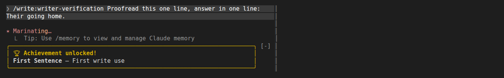
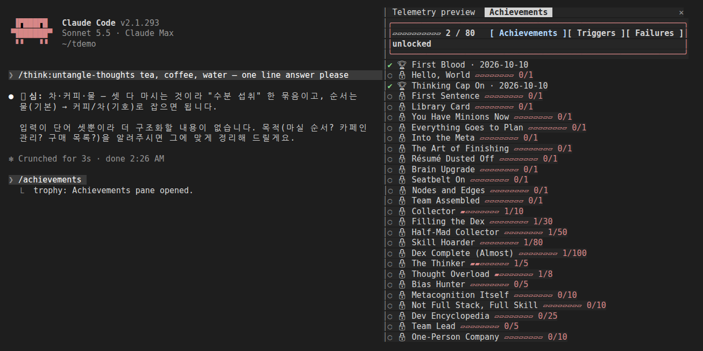
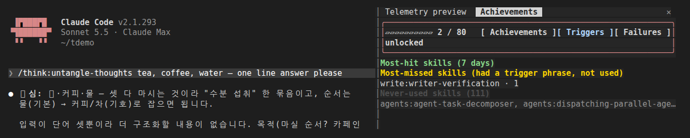
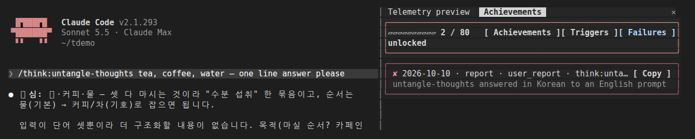
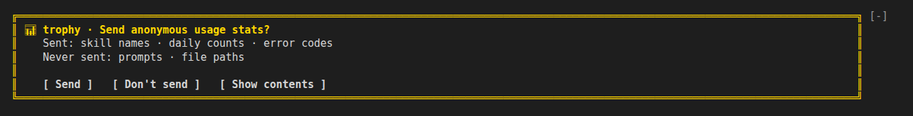
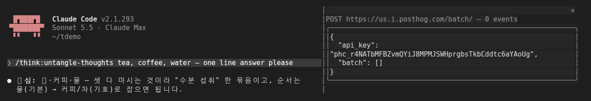
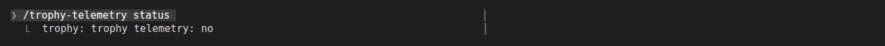

# trophy — 한국어

[English](README.md) · **한국어**

이 마켓플레이스의 스킬을 쓸 때마다 스팀 업적처럼 해금되는 플러그인입니다. 스킬을 쓰면 `◆ plugin:skill` 토스트가 뜨고, 해금되면 토스트와 프롬프트 위
황금 카드(8초)로 해금 소식이 뜨고, `/achievements`에서 해금한 업적·잠긴 업적·진행도, 그리고 스킬의 트리거 문구가 프롬프트에
있었는데 스킬이 실행되지 않은 경우를 볼 수 있습니다. 이 마켓플레이스의 스킬과 MCP 도구가 실패한 기록도 로컬에
남깁니다(**실패** 탭). 익명 일별 통계와 고정 오류 코드는 직접 동의했을 때만 메인테이너에게 전송됩니다.
기본값은 꺼짐입니다.

Claude Code 훅 모듈(`hooks/mod.tsx`)입니다. Claude Code 2.1.292 이상, 대화형 세션이 필요합니다.
`hooks/hooks.json`에서 `modules` 줄을 지우면 아무것도 남지 않습니다.

## 설치 / 제거

```bash
/plugin install trophy@newkayak12-claude-skills
/plugin uninstall trophy@newkayak12-claude-skills
```

UI는 기본적으로 영어이고, Claude Code의 `language` 설정이 한국어이면 한국어로 바뀝니다. 동의 질문이 알리는 데이터는 두 언어가 같습니다. 이 파일과 [README.md](README.md)는 함께 갱신합니다.

## 사용법

| 하고 싶은 일 | 방법 |
|---|---|
| 업적과 진행도 보기 | `/achievements` (**업적**, **트리거**, **실패** 탭이 있는 패널) |
| 실패한 것 보기 | **실패** 탭, 또는 프롬프트 위 `✘ N trophy <마지막 실패>` 줄의 **보기** |
| 마지막 스킬의 문제 신고 | `/trophy-bug <메모>` (메모는 로컬에만 남고, 고정 코드 `user_report`만 전송될 수 있음) |
| 대화창에서 보기 | `trophy:list` 스킬 (`~/.claude/trophy/profile.json`을 읽음) |
| 익명 통계 켜기 / 끄기 / 확인 | `/trophy-telemetry on`, `off`, `status` |

스킬은 실행되는 순간 기록됩니다 — `/name`으로 직접 입력했을 때, 모델이 Skill 도구로 불렀을 때, 미리
로드됐을 때 모두 해당합니다. 업적 80개는 `data/achievements.ts`에 있습니다(플러그인별 첫 사용, 전체·플러그인별
스킬 1~100종 수집, 3~365일 연속, 즐겨 쓰는 스킬 반복 횟수, 한 세션 콤보 15종, 숨김 5개).

이 마켓플레이스의 스킬이 로드에 실패하거나 성공하지 못했을 때, MCP 도구가 실패했을 때, 하네스 실행이 실패한
서브골이나 목표 게이트를 남겼을 때 실패로 기록합니다(하네스 결과는 로컬에만 남음). 각 기록에는 실패한 플러그인의
버전과 Claude Code 릴리스가 함께 남습니다. 원래 오류 텍스트는 내 컴퓨터에만 남고, **복사** 버튼은 이를 버그 본문으로
복사합니다.

키보드: 동의 질문에만 키가 있습니다. `ctrl+x tab`으로 밴드에 포커스를 두고 `s`/`n`/`p`를 누르거나 Tab/방향키와 Enter로 이동합니다. `Esc`로 돌아오고 `ctrl+x ctrl+a`로 밴드를 접습니다.

대화형이 아닌 세션(`claude -p`, 즉 teams/graph 어댑터 세션 전부)은 아무것도 기록하지 않습니다.

## 스크린샷

Claude Code 2.1.293 터미널에서 실제로 캡처한 화면입니다 (영어 UI).


스킬을 써서 업적을 풀자마자 프롬프트 위에 뜨는 금색 카드.


`/achievements`: 업적 탭. 푼 업적과 잠긴 업적의 ▰▱ 진행 막대.


트리거 탭: 프롬프트에 `write:writer-verification`의 트리거 문구가 있었지만 스킬은 실행되지 않음.


실패 탭: `/trophy-bug`로 남긴 보고와 **복사** 버튼.


프롬프트 위의 동의 질문. 답하기 전에는 아무것도 보내지 않습니다.


**Show contents**: 다음 전송의 JSON 그대로 (여기서는 이벤트 0개).


거절한 뒤의 `/trophy-telemetry status`. (이전 캡처: 지금의 `status`는 마지막 전송도 보여줍니다.)

## 텔레메트리 — 무엇을, 어디로 보내고, 어떻게 끄는가

**동의하지 않으면 아무것도 전송되지 않습니다.** 첫 업적이 해금되면 프롬프트 위 이중 테두리 상자로 묻습니다(보내는 것, 보내지 않는 것, 똑같은 모양의 버튼 세 개).
`[내용 보기]`를 누르면 다음에 보낼 JSON을 그대로 보여줍니다. 답하기 전에는 아무것도 내 컴퓨터를 떠나지
않습니다. 거절하면 기억하고 다시 묻지 않습니다. 답은 질문 버전과 함께 저장됩니다(v3는 플러그인·Claude Code
버전, OS 종류, 실행 결과를 추가). 이전 질문(v1, v2)에 한 동의는 한 번 다시 묻고, 답하기 전까지 trophy도 전송하지 않습니다.

'예'로 답하면(`[보내기]` 또는 `/trophy-telemetry on`) 어제까지의 날들을 바로 보내고, 응답이나 토스트가 몇 개를
보냈는지 알려줍니다. 그 뒤로는 새 UTC 날의 첫 대화형 세션 시작 때마다 PostHog
(`https://us.i.posthog.com/batch/`, 메인테이너의 프로젝트)로 보냅니다. 이벤트의 날짜는 전송 시각이 아니라
집계한 날입니다. 하루 단위로:

| 이벤트 | 속성 |
|---|---|
| `skill_used` | 스킬 이름, 플러그인 이름, 날짜, 횟수, `plugin_version` |
| `trigger_result` | 스킬 이름, 날짜, (트리거 문구가 있었고 스킬이 실행됨 / 실행 안 됨 / 문구 없이 실행됨) 횟수, `plugin_version` |
| `achievement_unlocked` | 업적 id |
| `plugins_installed` | 플러그인 이름, 날짜 — 세션이 스킬을 나열한 이 마켓플레이스 플러그인마다 하나 |
| `daily_active` | 날짜, Claude Code 릴리스(`cc_version`), OS 종류(`darwin`, `linux`, `win32`, `other`), `sessions` |
| `mcp_tool_result` | 날짜, 플러그인 이름, MCP 도구 이름, `ok`·`error` 횟수, `plugin_version` |
| `run_outcome` | 날짜, `system`(`graph`, `teams`, `harness`), `outcome`(`pass`, `reject`, `fail`), 횟수 |
| `diag_*` | skill·plugin·MCP tool 이름, 오류 코드(`reason`), `count`, `day`, 플러그인 버전(`plugin_version`), Claude Code 릴리스(`cc_version`) — 고정 코드; 메시지·경로·프롬프트 없음. |
| `$exception` | 이 모듈 내부 오류 메시지. 파일 경로는 모두 `<path>`로 바뀌고 300자까지 |

모든 이벤트에는 무작위 설치 id(첫 실행 때 생성, 사용자나 기기에서 유도하지 않음)와
`$process_person_profile: false`가 붙습니다. **절대 보내지 않는 것:** 프롬프트 내용, 작업 디렉터리,
프로젝트·파일 이름, 파일 경로, 세션 id, 사용자 이름·이메일. PostHog 프로젝트는 클라이언트 IP를 버리도록
설정되어 있고("Discard client IP data" 켜짐), 코드에 있는 프로젝트 토큰은 쓰기 전용입니다.

전송에 실패해도 아무것도 바뀌지 않으며, 다음 대화형 시작이나 `/trophy-telemetry on` 때 다시 시도합니다.

새 행의 뜻:
- `sessions`는 그날의 대화형 세션 시작 횟수입니다(resume, `/clear`, 모드 리로드도 각각 셀 수 있음). 세션이 UTC 자정을
  넘겨 열려 있어서만 활성이 된 날은 `sessions: 0`을 보냅니다.
- `ok`는 전송 계층의 성공입니다: 도구가 `isError` 없이 답했다는 뜻. 도구가 `{"error": …}`를 정상 결과로 돌려줘도 ok로 셉니다.
- `run_outcome`은 graph·teams·harness 모드가 보고 발행한 결과(id 없이 두 라벨만)의 횟수이며, 실행 횟수가 아닙니다.
  pass / (pass + reject + fail)은 실행별 성공률이 아닙니다. 한 실행이 여러 결과로 셀 수 있습니다(차단됐다가 나중에
  완료된 graph 실행은 fail과 pass, 하위 목표가 실패하고 목표 게이트도 실패한 harness 실행은 fail과 reject).
  대화형 세션 밖에서 끝나거나 끝나기 전에 세션이 닫힌 실행은 세지 않고, 열려 있는 두 세션이 본 같은 결과는 두 번 셉니다.

**끄기:** `/trophy-telemetry off` (Claude Code 저장소에 저장되며 즉시 적용), 또는 플러그인 제거.
`/trophy-telemetry status`로 현재 답과 마지막 전송(시각, 날짜 범위, 이벤트 수, 결과)을 확인합니다. 로컬에는 Claude Code의 플러그인 저장소와
`~/.claude/trophy/profile.json`(업적과 횟수, 프롬프트 없음)만 남습니다.

## 스킬

### `trophy:list`

패널과 같은 목록을 표로 출력합니다. `~/.claude/trophy/profile.json`에서 읽습니다 — 해금한 업적(날짜),
잠긴 업적(진행 막대, 숨김은 `???`), 최근 7일 트리거 현황(가장 많이 맞은 것·놓친 것·한 번도 안 쓴 것).

## 한계

- 조직 정책이 사용자 수준 `skill.prompt` 훅을 건너뛰는 경우에도 기록됩니다. 이 플러그인은 Skill 도구 호출과
  입력한 명령의 확장도 함께 듣고, 한 번의 사용은 한 번만 셉니다.
- 업적은 설치한 날부터 집계하며 소급하지 않습니다.
- 사용자 수준 classic 훅을 건너뛰는 조직 정책에서는 `PostToolUseFailure` 실패 기록이 실행되지 않아 그 경로의
  `diag_mcp_error`와 스킬 `is_error` 코드가 남지 않습니다. MCP 횟수는 계속 실행되는 `tool.call`로 셉니다.
- `mcp_tool_result.error`는 모든 `isError` 결과를, `diag_mcp_error`는 `PostToolUseFailure`가 실행되는 곳만 셉니다.
  둘은 어긋날 수 있고 서로에서 유도되지 않습니다.
- 병렬 MCP 호출(과 거의 동시에 일어난 결과 기록)은 횟수를 놓칠 수 있습니다: 다른 카운터처럼 과소 집계입니다.

## 상태 로그

- v0.8.5 — Codex 매니페스트에 trophy가 Claude 전용이라고 적습니다.
- v0.8.4 — Codex는 명시적인 빈 스키마 호환 훅 오버레이를 사용하고 Claude 전용 `trophy:list`를 노출하지 않습니다. Claude 훅과 업적 동작은 변경되지 않습니다.
- v0.8.3 — 트리거 데이터에서 삭제된 `portfolio:feedback-beta`와 `assist` 스킬을 뺐습니다.
- v0.8.2 — 영어 트리거 문구는 단어 경계에서만 맞습니다. `done`이 `abandoned` 안에서 걸리지 않습니다.
- v0.8.1 — Codex: MCP 서버가 Codex에서도 등록됩니다(`.codex-plugin/plugin.json`, `${PLUGIN_ROOT}`). Claude는 plugin.json에서 읽습니다.
- 0.8.0 — 은퇴한 `mods` 플러그인의 스킬 토스트를 가져왔습니다: 이 마켓플레이스의 Skill 도구 호출마다 `◆ <plugin:skill>` 토스트 하나, 그 호출로 업적이 해금되면 생략(🏆 토스트가 대신함). 대화형 세션에서만.
- 0.7.1 — 키보드 키는 동의 질문(s/n/p)에만 남깁니다. 실패 행과 패널은 0.6.1로 되돌렸습니다(닫기 버튼 없음, 키 힌트 없음).
- 0.7.0 — 모든 컨트롤을 키보드로 누를 수 있고 라벨에 키가 보입니다: `보기 [v]`, 새로 생긴 `닫기 [d]`(패널을 열지 않고 배지만 지움), 패널 탭 `[t]` `[r]` `[f]`, 동의 버튼 `s`/`n`/`p`. `/achievements`는 키 입력이 가능한 상태로 패널을 엽니다. 기록·전송 내용과 동의 버전은 그대로.
- 0.6.1 — 타입 계약에 `anyUnlocked`와 `lang`을 선언해 `claude plugin validate`가 다시 통과합니다(0.6.0은 검증에 실패했지만 모드는 정상 로드·동작). 동작 변화 없음.
- 0.6.0 — 동의 질문은 첫 업적이 해금될 때 뜹니다. 해금한 업적이 없으면 Claude Code를 켜도 상자가 나오지 않습니다. 이미 답했는데 시작할 때 질문이 잠깐 비치던 문제도 고쳤습니다. 보내는 내용과 동의 버전은 그대로.
- 0.5.0 — 기본은 영어, Claude Code의 `language`가 한국어면 한국어: 모든 패널, 밴드, 명령 응답, 업적 80개(한국어 문구는 그대로). 동의 질문이 눈에 띄게 바뀜: 이중 테두리 상자에 보내는 것과 보내지 않는 것을 따로 적고 버튼 세 개는 똑같은 모양. 보내는 내용, 묻는 시점, 동의 버전은 그대로. 실제 Claude Code 영어·한국어 캡처로 확인.

- 0.4.0 — diag 플러그인을 trophy로 합치고 제거했습니다. trophy가 실패를 직접 기록하고(**실패** 탭, `✘` 줄,
  `/trophy-bug`), 같은 동의로 `diag_*` 코드를 플러그인·Claude Code 버전과 함께 보냅니다. 이 마켓플레이스의 다른
  플러그인은 모두 `dependencies`에 trophy를 적어, 하나만 설치해도 trophy가 함께 설치됩니다.

- 0.3.0 — 업적 해금 시 금색 카드가 밴드에 8초간 표시; 잠긴 업적에 ▰▱ 진행 바; Ink 스타일 패널과 동의 밴드.
- 0.2.1 — 동의 밴드가 아래 밴드를 더 이상 가리지 않습니다.
- 0.2.0 — 동의 문구 v2에 오류 코드를 명시합니다. 답은 문구 버전과 함께 저장되고, v1에 '예'로 답했다면 한 번 더
  묻고, 답하기 전까지 아무것도 보내지 않습니다. 전송 표에 `diag_*` 행을 추가했습니다.
- 0.1.1 — 직접 입력한 `/스킬` 명령도 기록됩니다. 팀 조직 계정에서는 사용자 플러그인의 `skill.prompt`·
  `UserPromptExpansion` hook이 건너뛰어지므로, 이제 `prompt.submit`에서 입력한 명령을 읽습니다(원문·확장형 모두).
- 0.1.0 — 첫 릴리스.
